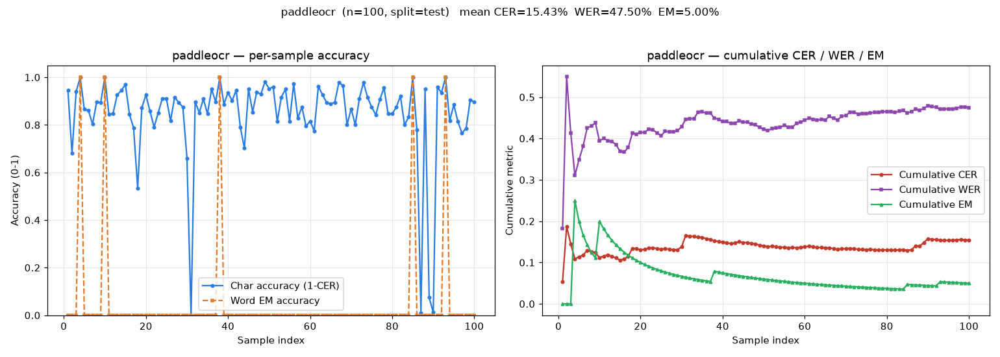
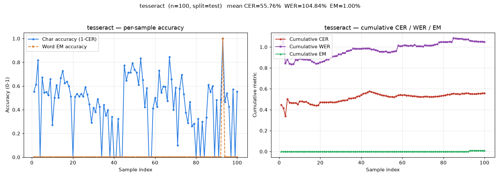
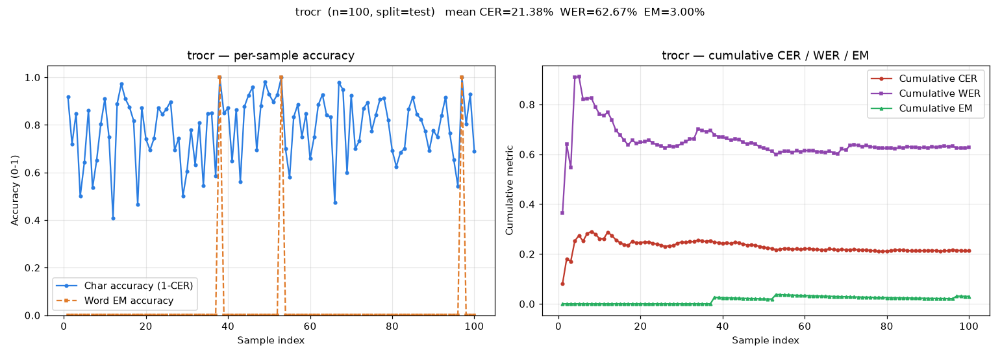
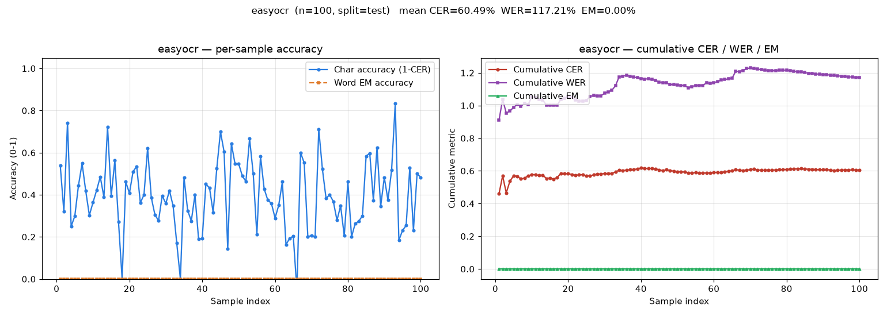

# Mint — OCR Benchmark on RIMES-2011 (French Handwriting)

A reproducible benchmark harness that measures how four open-source OCR
engines read **French handwritten lines** from the
[Teklia/RIMES-2011-line](https://huggingface.co/datasets/Teklia/RIMES-2011-line)
dataset (100 test lines). Everything runs **CPU-only** on Python 3.11 /
Windows.

## Models tested

| Model                  | Script             | Notes |
|------------------------|--------------------|-------|
| **PaddleOCR** (PP‑OCRv4/v5) | `paddleocr_test.py` | PaddlePaddle DBNet detector + CRNN recognizer. **Winner.** |
| **TrOCR** (HF, `fra`)  | `trocr_test.py`    | `Google/trocr` vision-encoder-decoder, French handwriting checkpoint. |
| **EasyOCR** (CRAFT+CRNN) | `easyocr_test.py`  | Print-optimized detector+rec. Handwriting is out of domain. |
| **Tesseract** (LSTM v5) | `tesseract_test.py` | UB-Mannheim Windows binary via `pytesseract`. Fastest (159 ms). |

## Setup

### 1. Python environment

```powershell
py -3.11 -m venv .venv
.\.venv\Scripts\Activate.ps1
python -m pip install -U pip
pip install -r requirements.txt
```

`requirements.txt` is **pinned to the exact `pip freeze` set** that produced
the numbers in this repo (Python 3.11, Windows, CPU-only). If you move to a
different OS/Python, use the `>=` floors as the starting point instead.

### 2. Tesseract binary (only for `tesseract_test.py`)

Tesseract is an external native binary, **not** a pip package. Install once:

- **Windows**: UB-Mannheim build — <https://github.com/UB-Mannheim/tesseract/wiki>
  (default install path `C:\Program Files\Tesseract-OCR`).
- **French language model** (the one RIMES-2011 needs):
  download <https://github.com/tesseract-ocr/tessdata_fast/raw/main/fra.traineddata>
  and place it at `<install>\tessdata\fra.traineddata`.

The script auto-discovers the binary and, if `TESSDATA_PREFIX` is not set,
falls back to scanning `C:\Users\<you>\Desktop` + the install's own `tessdata`
for the language data.

### 3. The dataset

No manual download — every script pulls it from the Hugging Face Hub on first
run and caches it under `%USERPROFILE%\.cache\huggingface\datasets`. It is the
**default configuration** (French handwriting) of `Teklia/RIMES-2011-line`.

## How to run

All four share the same flags via the shared harness in `ocr_eval.py`:

| Flag                | Meaning                                        |
|---------------------|------------------------------------------------|
| `--limit N`         | how many test samples to run (default `100`; use `1` for a smoke test) |
| `--split test`      | `test` (default), `train`, `validation`       |
| `--results-dir DIR` | where to write CSV + PNG (default `results/`) |
| `--no-graph`        | skip the PNG, keep just the CSV                |
| `--lang <code>`     | **tesseract only** — force language, e.g. `fra` |
| `--psm <int>`       | **tesseract only** — page segment mode, default `7` (single line) |

```powershell
python paddleocr_test.py --limit 100
python tesseract_test.py --lang fra --limit 100
python trocr_test.py     --limit 100
python easyocr_test.py   --limit 100
```

Each run prints a `===== RESULTS =====` block with mean **CER / WER / EM** and
average inference latency, then writes:

- `results/<model>_test.csv` — per-sample `gold`, `pred`, `cer`, `wer`, `em`, `infer_ms`
- `results/<model>_test.png` — 2-panel chart:
  - *Left*: per-sample char-accuracy + word-EM accuracy
  - *Right*: cumulative (rolling) CER / WER / EM

## Where to look at the 4 PNGs

They are right here, next to the four CSVs:

| Chart | File |
|-------|------|
| PaddleOCR |  |
| Tesseract |  |
| TrOCR     |  |
| EasyOCR   |  |

CSVs of the same runs are alongside them (`results/<model>_test.csv`).

## Results at a glance

| Model        | CER     | WER      | Exact match | Avg infer (CPU) |
|--------------|---------|----------|-------------|-----------------|
| **paddleocr**| **15.43%** | **47.50%** | **5.00%** | 2635.81 ms |
| tesseract    | 55.76%  | 104.84%  | 1.00%       | **158.95 ms** |
| trocr        | 21.38%  | 62.67%   | 3.00%       | 6843.66 ms    |
| easyocr      | 60.49%  | 117.21%  | 0.00%       | 1071.42 ms    |

**Winner: PaddleOCR (PP‑OCRv4/v5).** See [REPORT.md](REPORT.md) for the
winner deep-dive, why the others lose, and the next-stage fine-tuning plan.

## Repo layout

```
Mint/
├── README.md                  this file
├── REPORT.md                  findings, winner analysis, fine-tuning roadmap
├── requirements.txt           exact pinned dependency set (pip freeze)
├── model_test.txt             raw stdout of the 4 runs + summary table
├── ocr_eval.py                shared harness (dataset → predict → CER/WER/EM → CSV/PNG)
├── paddleocr_test.py          ▶ winner script
├── tesseract_test.py
├── trocr_test.py
├── easyocr_test.py
└── results/
    ├── paddleocr_test.{png,csv}
    ├── tesseract_test.{png,csv}
    ├── trocr_test.{png,csv}
    └── easyocr_test.{png,csv}
```

## Metrics

- **CER** — character error rate: Levenshtein distance(gt, pred) / len(gt)
- **WER** — word error rate: token-level Levenshtein / n_gt_words
- **EM**  — exact-match rate: `normalize(pred) == normalize(gt)` (case/diacritic normalized)
- **Latency** — wall-clock ms per `predict()` call, mean over the run

## License

Code provided as-is for research / benchmarking. Each engine is licensed
separately: [PaddleOCR](https://github.com/PaddlePaddle/PaddleOCR) (Apache-2.0),
[Tesseract](https://github.com/tesseract-ocr/tesseract) (Apache-2.0),
[TrOCR via HF](https://huggingface.co/google/trocr-base-handwritten-fra),
[EasyOCR](https://github.com/JaidedAI/EasyOCR) (Apache-2.0). The RIMES-2011
benchmark corpus is public on Hugging Face.
